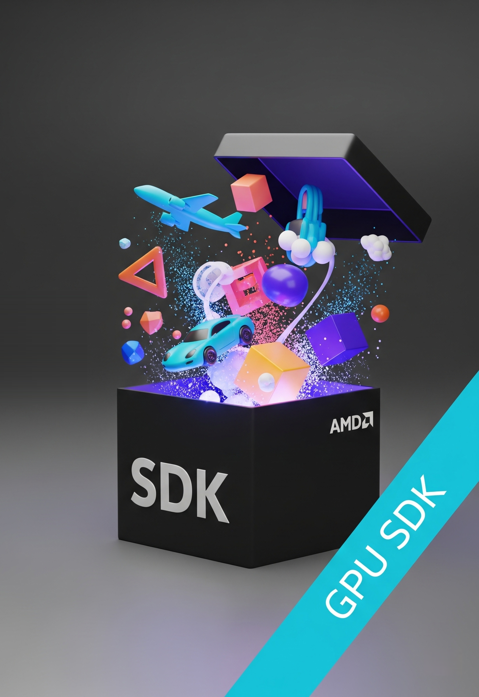

# AMD GPU Unified SDK

**A unified development toolkit for AMD Kria, Zynq UltraScale+, and Versal platforms — bringing the OpenGL ES, OpenCL, and Vulkan SDKs together in a single tree.**

[](docs/html/index.html)
[](https://www.amd.com)
[](https://www.khronos.org/opengles/)
[](https://www.khronos.org/opencl/)
[](https://www.khronos.org/vulkan/)

## 🚀 **Overview**

The AMD GPU Unified SDK consolidates the three previously separate GPU SDKs —
**OpenGL ES**, **OpenCL**, and **Vulkan** — into one CMake project with shared
support libraries and a common build system. It targets AMD embedded platforms
including **Kria, Zynq UltraScale+, and Versal** systems, and
ships out-of-the-box samples that customers can use as a starting point for new
applications and to explore implementation possibilities.

### ✨ **Key Features**

- **🎯 Comprehensive Sample Suite**: Graphics (OpenGL ES / Vulkan) and compute
  (OpenCL) samples covering basic to advanced techniques.
- **🏗️ Shared SDK Libraries**: Common, EGL, GLES, and Vulkan helper libraries
  reused across all sample sets.
- **🖥️ Multi-Platform Windowing**: Wayland, X11, and framebuffer (fbdev) backends
  selectable at configure time.
- **⚡ Performance Optimized**: Leverages Mali 400 / Mali G78AE GPU hardware acceleration.
- **🔧 Developer-Friendly**: One CMake configuration builds the whole tree.

## 📋 **Supported Platforms**

| Platform | Architecture | GPU | APIs | Status |
|----------|-------------|-----|------|--------|
| AMD Kria SOM | ARM64 | Mali 400 | OpenGL ES | ✅ Full Support (X11, FBDEV, Wayland)|
| Zynq UltraScale+ | ARM64 | Mali 400 | OpenGL ES | ✅ Full Support (X11, FBDEV, Wayland)|
| Versal AI Edge Series Gen 2 | ARM64 | Mali G78AE | OpenGL ES / OpenCL / Vulkan | ✅ Full Support (FBDEV, Wayland)|

---

# Project structure

- cmake
  - modules - Additional CMake module wrappers
    - ecm   - Extra CMake Modules (used in Wayland protocol compilation)
- 3rdparty - Bundled third-party code
  - stb    - stb_image.h single-header image loader (used by the Vulkan framework)
- lib
  - sdk
    - common - Common graphical API agnostic helper classes
    - egl    - EGL helper classes
    - gles   - GLES helper classes
    - vulkan - Vulkan helper classes (RAII API)
    - vulkan-strings    - Vulkan API identifiers to string convertor (debugging purposes)
    - vulkan-vendor-ids - GPU vendor name resolution from PCI ID global database (debugging purposes)
- samples
  - vulkan
    - basic-compute   - Compute-shader particle simulation rendered via graphics
    - triangle        - Trivial triangle rendering
    - texture         - Rotating textured quad (Vulkan image sampling)
    - spinning-cube   - Textured 3D cube with depth buffering
    - multipass       - Deferred shading with multiple subpasses
    - multisampling   - MSAA rendering
    - mipmapping      - Mipmap generation and sampling
    - astc            - ASTC compressed texture sampling (with PNG fallback)
    - multithreading  - Multi-threaded secondary command buffer recording

    All Vulkan samples select the windowing backend at runtime:
      --wayland  VK_KHR_wayland_surface (under a compositor such as Weston)
      --display  VK_KHR_display (direct DRM/KMS, no compositor)
      (no flag)  auto: wayland if a compositor socket is present, else display
  - opengles - OpenGL ES samples, grouped by GLES version. All samples build on
    the `SdkGlesFramework` (lib/sdk/GlesFramework) except the standalone
    FBDEV-only EGLImage and OpenCL demos noted below.
    - opengl_es_2.0
      - trianglesample               - Anti-aliased spinning triangle
      - alpha_depthsample            - Alpha blending and depth testing
      - bbox                         - Bounding-box rendering with on-screen text
      - eglpreserve                  - EGL_BUFFER_PRESERVED swap behaviour
      - eglrenderingsample           - EGLImage rendering (standalone, FBDEV only)
      - framebufferobject-fbosample  - Render-to-texture via an FBO
      - multicubesample              - Multiple textured spinning cubes
      - particlerenderingsample      - GPU particle / molecule system
      - rotozoom                     - Rotation/zoom texture effect
      - shadowsample                 - Shadow mapping
      - texturemipmapsample          - ETC mip-mapped textures
      - waveformsample               - Animated waveform rendering
      - yuv2rgbsample                - YUV-to-RGB colour conversion on the GPU
    - opengl_es_3.0
      - compute_particles            - Compute-shader particle system
      - occlusion_culling            - Hi-Z GPU occlusion culling
      - opencl_matmul                - OpenCL matrix multiply (built only when OpenCL is found)

    Each sample is installed into `bin/<sample>/` with its shaders/assets staged
    alongside the binary: per-sample shaders in `Supportingfiles/`, the shared
    font shaders in `FontShaders/`, and any extra data (`models/`, `assets/`,
    `cl_kernels/`). The samples load these with paths relative to the working
    directory, so run each one from its own install directory (e.g.
    `cd bin/trianglesample && ./trianglesample`).

    The windowing backend of the framework-based samples is selected at configure
    time with `-D SDK_Platform=<wayland|x11|fbdev>` (default `wayland`):
      - `wayland` - render through a Wayland (xdg-shell) surface; run under a
        compositor such as Weston.
      - `x11`     - render into an X11 window; run under an X server.
      - `fbdev`   - render directly to the Linux framebuffer (EGL_DEFAULT_DISPLAY);
        run from a bare console.
    Exactly one backend is compiled, and only that backend's system libraries are
    linked. `eglrenderingsample` is a standalone EGLImage demo that manages its
    own surface; it is **FBDEV only** (run from a bare console). It builds
    independently of `SDK_Platform` (its build links X11 for the standalone
    codebase, but the sample is intended to run on the framebuffer).
  - opencl
    - hello-world-c           - Array addition on the CPU only (no OpenCL, baseline reference)
    - hello-world-opencl      - Array addition in an OpenCL kernel (scalar)
    - vector-hello-world      - Array addition using vectorized OpenCL types
    - opencl-template         - Minimal skeleton that runs a no-argument kernel
    - mandelbrot              - Mandelbrot set generation written to a bitmap
    - mandelbrot-benchmark    - Mandelbrot generation with image perturbation and timing
    - matrix-multiply         - SGEMM benchmark suite (many kernel variants, CSV output)
    - sgemm                   - Single-precision matrix multiply (alpha*A*B + beta*C)
    - gaussian-filter         - Gaussian blur of a PNG image
    - convolution-filter      - User-defined 3x3/5x5 convolution filter
    - fir-filter              - FIR (finite impulse response) image filter
    - sobel-filter            - Sobel edge detection using vector loads (dX, dY, combined)
    - sobel-filter-no-vectors - Sobel edge detection, one pixel per work item
    - image-scaling           - Image upscaling using OpenCL image objects and a sampler
    - integer-64-bit          - Pixel sum/sum-of-squares using 64-bit ints and atomics
    - depth-map               - Stereo disparity / obstacle detection from two images
    - adas-lane-detection     - Lane visualization via Sobel edge detection (ADAS)
    - ml-classifier           - Average-intensity feature + linear "Bright/Dark" classifier

    Most OpenCL samples read their inputs from `assets/` (relative to the
    executable) and write results (e.g. `output.bmp`/`output.png`) into the
    current working directory.


# Build

SDK application uses CMake as a build system and comes with
most of the build time dependencies through the Google repo.

Instructions below assume that path to the repo checkout is at `/path/to/src`.

> **Important:** No sample sets are built by default. Add a platform preset
> (e.g. `-D SDK_PLATFORM_TARGET=versal-2ve-2vm`) or per-API switches
> (e.g. `-D SDK_BUILD_VULKAN=ON`) to your `cmake` command — see
> [Selecting what to build](#selecting-what-to-build) below.

## Target configuration

Target build requires installed Yocto SDK with populated target sysroot.
Assuming Yocto SDK ins installed at `/yocto/build/tmp/deploy/sdk/`.

```bash
source /yocto/build/tmp/deploy/sdk/environment-setup-cortexa72-cortexa53-amd-linux

AMD_SDK=/yocto/build/tmp/deploy/sdk/ \
cmake \
    -G Ninja \
    -D CMAKE_BUILD_TYPE=Release \
    -D CMAKE_TOOLCHAIN_FILE=sdk.cmake \
    -D SDK_Platform=wayland \
    -D SDK_PLATFORM_TARGET=versal-2ve-2vm \
```

`SDK_Platform` selects the OpenGL ES samples' windowing backend
(`wayland` (default) | `x11` | `fbdev`); see the `samples/opengles` notes above.
`SDK_PLATFORM_TARGET` selects *which* sample sets are built (nothing by default);
see [Selecting what to build](#selecting-what-to-build) below.

## Selecting what to build

**Nothing is built by default** — you must opt in to the sample sets you want,
either with a target platform preset or with the explicit per-API switches.

### Target platform preset

`SDK_PLATFORM_TARGET` enables a set of sample sets based on the SoC's GPU
capabilities:

| `SDK_PLATFORM_TARGET` | GPU | Sample sets enabled |
|-----------------------|-----|---------------------|
| `none` (default) | — | nothing (use the per-API switches) |
| `versal-2ve-2vm` | Mali G78AE | OpenGL ES 2.0 + 3.0, OpenCL, Vulkan |
| `zynqmp` | Mali 400 | OpenGL ES 2.0 only |

```bash
# Build everything (Versal AI Edge Series Gen 2 / Mali G78AE) examples
AMD_SDK=/path/to/yocto_sdk cmake -G Ninja -D SDK_PLATFORM_TARGET=versal-2ve-2vm -D ...

# Build only the (ZynqMP / Mali 400) examples -> OpenGL ES 2.0 only
AMD_SDK=/path/to/yocto_sdk cmake -G Ninja -D SDK_PLATFORM_TARGET=zynqmp -D ...

Application and supporting files will be generated inside run folder in each sample application folder.

```

### Per-API switches

All sample sets are **OFF by default**. These ON/OFF options override the
platform preset, so any combination can be built:

| Option | Default | Effect |
|--------|---------|--------|
| `SDK_BUILD_OPENGLES` | OFF | Build the OpenGL ES samples |
| `SDK_BUILD_OPENGLES_2_0` | OFF | Build the OpenGL ES **2.0** samples |
| `SDK_BUILD_OPENGLES_3_0` | OFF | Build the OpenGL ES **3.0** samples |
| `SDK_BUILD_OPENCL` | OFF | Build the OpenCL samples |
| `SDK_BUILD_VULKAN` | OFF | Build the Vulkan samples |

> Enabling `SDK_BUILD_OPENGLES` without selecting a version builds **both** 2.0
> and 3.0; use `SDK_BUILD_OPENGLES_2_0` / `_3_0` to pick one.

```bash
# Build only the OpenCL samples
cmake -G Ninja \
    -D SDK_BUILD_OPENGLES=OFF -D SDK_BUILD_OPENCL=ON -D SDK_BUILD_VULKAN=OFF \
    /path/to/sdk -D ...

# Build only the Vulkan samples
cmake -G Ninja \
    -D SDK_BUILD_OPENGLES=OFF -D SDK_BUILD_OPENCL=OFF -D SDK_BUILD_VULKAN=ON \
    /path/to/sdk -D ...

# Build only the OpenGL ES samples (both versions)
cmake -G Ninja \
    -D SDK_BUILD_OPENGLES=ON -D SDK_BUILD_OPENCL=OFF -D SDK_BUILD_VULKAN=OFF \
    /path/to/sdk -D ...
```

Only the support libraries for the enabled sample sets are built, so a subset
build does not require the toolchain packages of the disabled APIs (e.g. a
ZynqMP / OpenGL-ES-only build needs neither the Vulkan nor OpenCL SDK packages).

> **Note:** Because these are cached CMake options, switching
> `SDK_PLATFORM_TARGET` after a first configure does not retroactively change the
> per-API option values. To switch platforms cleanly, configure into a fresh
> build directory, or pass the `SDK_BUILD_*` switches explicitly.

## Compile

```bash
ninja
```


# Running the OpenCL samples

Each OpenCL sample is installed into `bin/<sample>/` together with its `assets/`
directory (kernels and input images). Because the samples load their kernels and
inputs with paths relative to the working directory (e.g. `assets/foo.cl`,
`assets/input.bmp`), run each sample from inside its own directory:

```bash
cd bin/gaussian_filter
./gaussian_filter
```

Notes:

- Outputs are written to the current directory: filter/image samples produce
  `output.bmp` or `output.png` (the Sobel samples additionally write
  `output-dX.bmp` and `output-dY.bmp`).
- Samples print OpenCL kernel profiling information (queued/wait/run time) on
  completion.

Sample-specific inputs and arguments:

- `matrix-multiply` accepts command line options (run `./matrix_multiply -h` for
  the full list, including `-va` to validate against a CPU reference and
  `-csv <file>` to dump results).
- `mandelbrot-benchmark` and `adas-lane-detection` expect a 1024x1024
  `assets/input.bmp`.
- `depth-map` expects a stereo pair `assets/left.bmp` and `assets/right.bmp`.
- `sobel-filter` expects an `assets/input.bmp` whose width is a multiple of 16.
- Image samples read `assets/input.bmp`.
- `integer-64-bit` reads `assets/input.bmp`, prints the pixel sum and
  sum-of-squares to the console (no output file), and requires the
  `cl_khr_int64_base_atomics` device extension.
- `hello-world-c`, `hello-world-opencl`, `vector-hello-world`, `opencl-template`
  and `sgemm` take no inputs and produce no image output.


---

# 🎨 Complete Sample Reference

> **Note on images:** The snapshots below reference artwork under
> `doc_imgs/opengles/`, `doc_imgs/opencl/`, and `doc_imgs/vulkan/`. Drop the
> corresponding image files into the matching folder to have them render here.

## OpenGL ES Samples

### **OpenGL ES 2.0 Samples**

#### 1. **Triangle Sample**
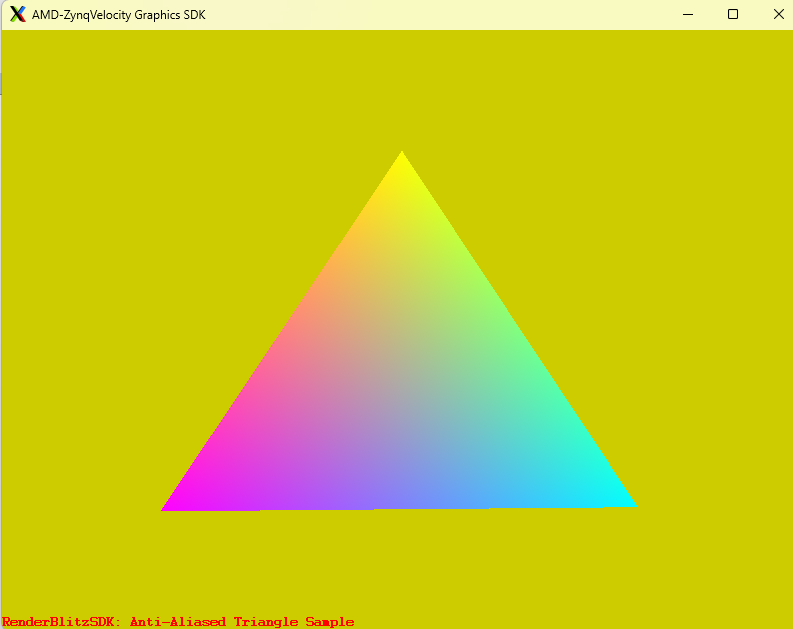

**📁 Source**: `samples/opengles/opengl_es_2.0/trianglesample/`

**Supported Window Environments:** ✅ FBDEV  ✅ X11  ✅ Wayland

**Description:** A basic triangle rendered in OpenGL ES 2.0 with color
interpolation across vertices and rotation matrices for dynamic animation. A
perfect starting point for learning OpenGL ES fundamentals.

**Key Techniques:** Vertex shaders, color interpolation, basic rendering pipeline, matrix transformations

---

#### 2. **MultiCube Sample**
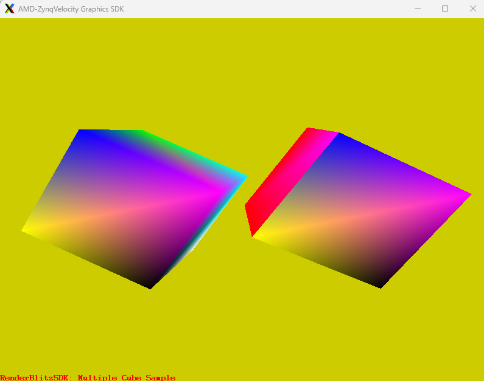

**📁 Source**: `samples/opengles/opengl_es_2.0/multicubesample/`

**Supported Window Environments:** ✅ FBDEV  ✅ X11  ✅ Wayland

**Description:** Demonstrates basic cube rendering with color interpolation and
rotation matrices, and the rendering of multiple objects. Essential for
understanding 3D transformations.

**Key Techniques:** 3D graphics, matrix operations, depth testing, multiple object rendering

---

#### 3. **Texture MipMap Sample**
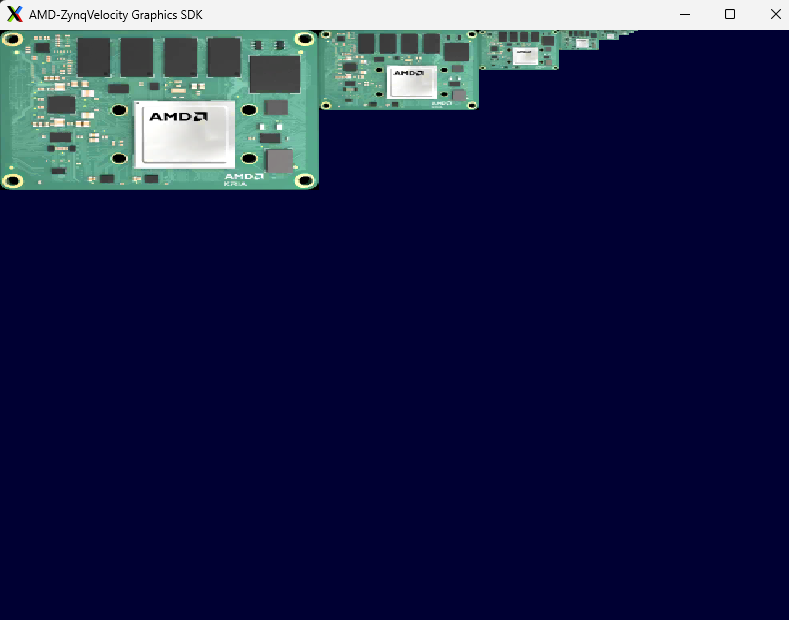

**📁 Source**: `samples/opengles/opengl_es_2.0/texturemipmapsample/`

**Supported Window Environments:** ✅ FBDEV  ✅ X11  ✅ Wayland

**Description:** Shows the Mali GPU decompressing a compressed texture on the fly
with multiple MIPMAP levels used as textures (stored as compressed ETC files).

**Key Techniques:** ETC1 compression, mipmap generation, texture optimization, GPU decompression

---

#### 4. **Alpha Depth Sample**
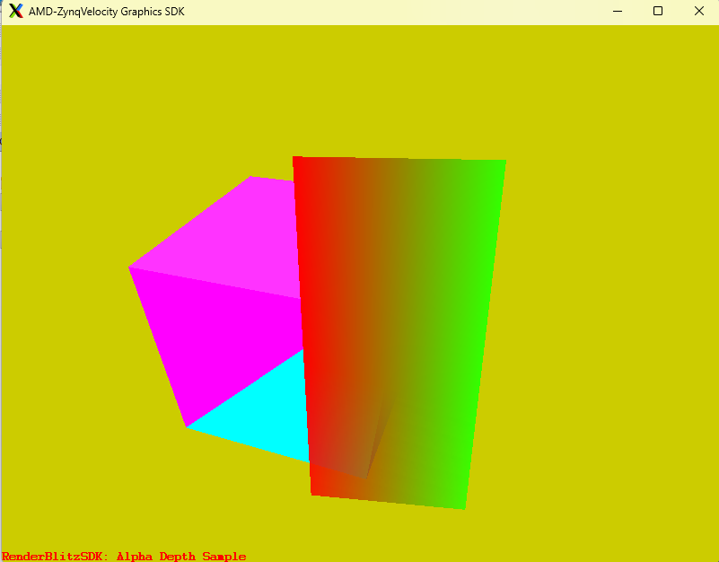

**📁 Source**: `samples/opengles/opengl_es_2.0/alpha_depthsample/`

**Supported Window Environments:** ✅ FBDEV  ✅ X11  ✅ Wayland

**Description:** Demonstrates transparency rendering and depth projection effects
with proper alpha blending and depth testing.

**Key Techniques:** Alpha blending, depth projection, transparency effects, render order management

---

#### 5. **Frame Buffer Object (FBO) Sample**
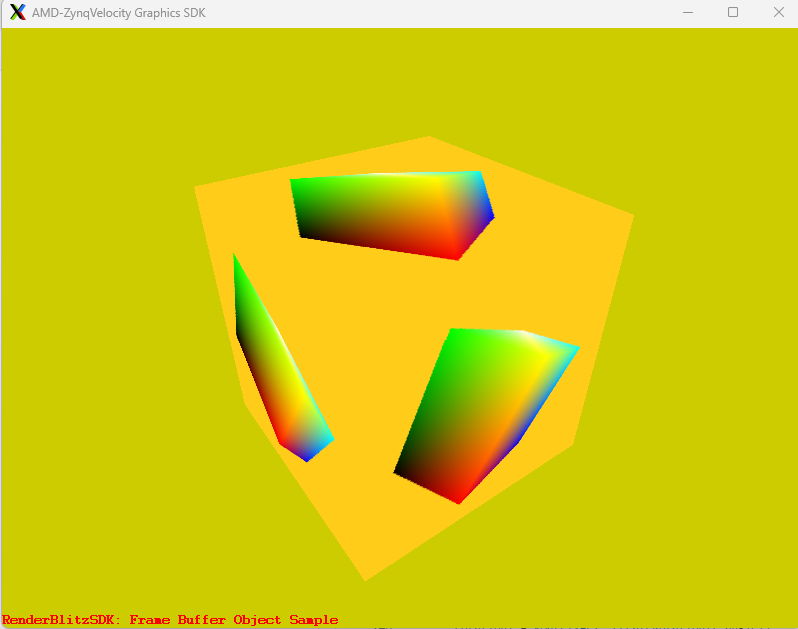

**📁 Source**: `samples/opengles/opengl_es_2.0/framebufferobject-fbosample/`

**Supported Window Environments:** ✅ FBDEV  ✅ X11  ✅ Wayland

**Description:** Render-to-texture using a framebuffer object: a colored cube is
rendered to a texture and applied across the faces of an outer cube, with both
cubes animated by rotation matrices.

**Key Techniques:** Render-to-texture, FBO management, multi-pass rendering, texture as render target

---

#### 6. **Particle Rendering Sample**
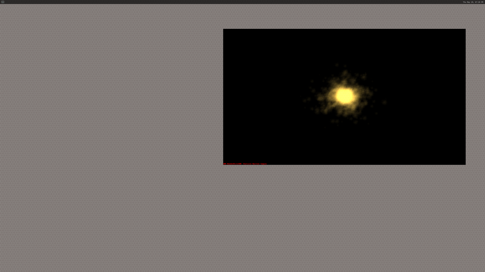

**📁 Source**: `samples/opengles/opengl_es_2.0/particlerenderingsample/`

**Supported Window Environments:** ✅ FBDEV  ✅ X11  ✅ Wayland

**Description:** Particle effect simulation on the Mali GPU. Draws many particles
created from a small texture, each with its own lifetime and color, animated via
matrices.

**Key Techniques:** Point sprites, physics simulation, dynamic particle management, GPU-based effects

---

#### 7. **Shadow Mapping Sample**
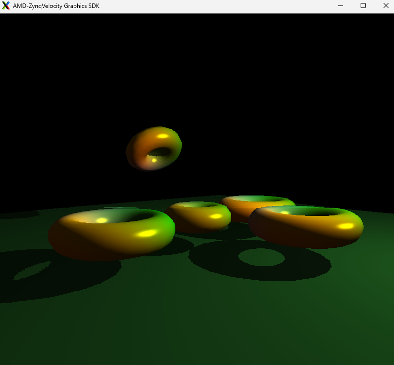

**📁 Source**: `samples/opengles/opengl_es_2.0/shadowsample/`

**Supported Window Environments:** ✅ FBDEV  ✅ X11  ✅ Wayland

**Description:** Showcases lighting and shadow effects on the Mali 400 GPU with
real-time shadow rendering techniques.

**Key Techniques:** Shadow maps, depth textures, multi-pass rendering, advanced lighting

---

#### 8. **Waveform Pattern Sample**
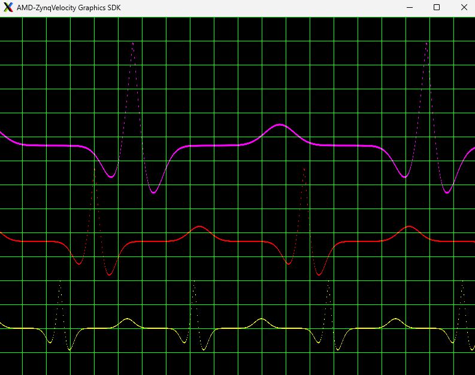

**📁 Source**: `samples/opengles/opengl_es_2.0/waveformsample/`

**Supported Window Environments:** ✅ FBDEV  ✅ X11  ✅ Wayland

**Description:** Waveform rendering using only GLSL shader code while minimizing
vertices; multiple waveforms are implemented with math functions in the pixel
shader.

**Key Techniques:** Vertex displacement, procedural animation, mathematical functions in shaders

---

#### 9. **RotoZoom Sample**
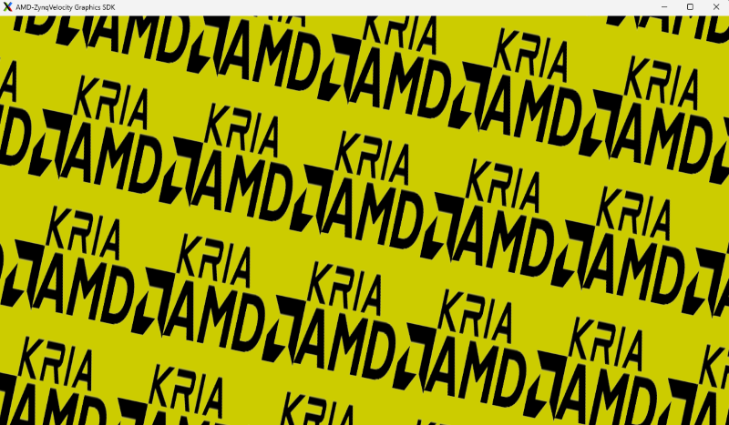

**📁 Source**: `samples/opengles/opengl_es_2.0/rotozoom/`

**Supported Window Environments:** ✅ FBDEV  ✅ X11  ✅ Wayland

**Description:** Classic demo effect showcasing 2D transformations and texture
sampling with rotation and zoom.

**Key Techniques:** 2D transformations, texture sampling, classic demo effects

---

#### 10. **YUV2RGB Conversion Sample**
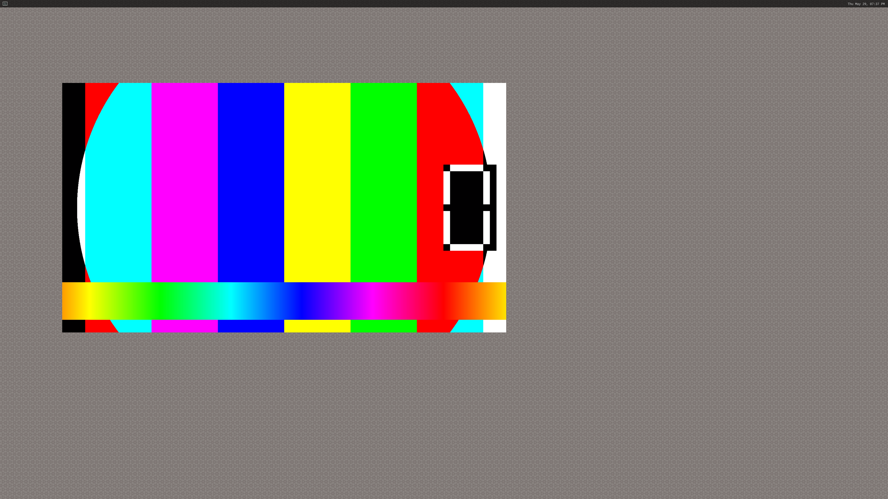

**📁 Source**: `samples/opengles/opengl_es_2.0/yuv2rgbsample/`

**Supported Window Environments:** ✅ FBDEV  ✅ X11  ✅ Wayland

**Description:** Fast color conversion from YUV to RGB in a GLSL shader on the
fly, rendering the converted image to the framebuffer frame by frame.

**Key Techniques:** Color space conversion, video textures, GPU-based color conversion

**Note:** *You must provide your own raw YUV (yuv420p) frame and pass it as the
first argument (e.g. `./yuv2rgbsample input.yuv`). Run the sample with `-h` for
usage details, including an `ffmpeg` command to generate a compatible file.*

---

#### 11. **EGL Image Texture Swapping Sample**
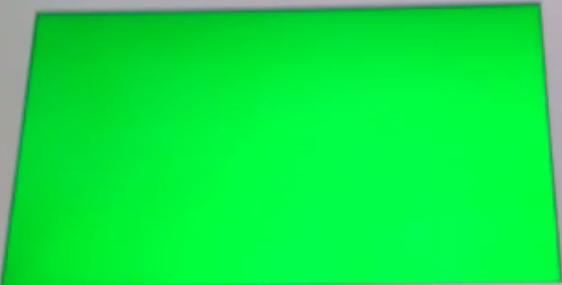

**📁 Source**: `samples/opengles/opengl_es_2.0/eglrenderingsample/`

**Supported Window Environments:** ✅ FBDEV only

**Description:** Showcases the EGL Image extension, which defines an EGL resource
type (EGLImage) suitable for sharing 2D arrays of image data between client APIs.

**Key Techniques:** EGL Image extension, texture sharing, EGL resource management

---

#### 12. **EGL Preserve Sample**
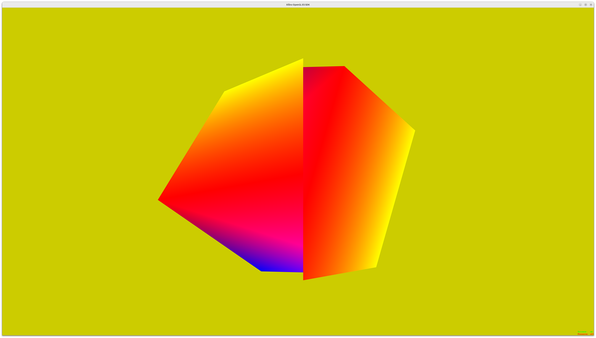

**📁 Source**: `samples/opengles/opengl_es_2.0/eglpreserve/`

**Supported Window Environments:** ✅ FBDEV  ✅ X11  ✅ Wayland

**Description:** Demonstrates EGL buffer preservation (`EGL_BUFFER_PRESERVED`)
and context management for efficient rendering and resource management.

**Key Techniques:** EGL context preservation, buffer management, efficient rendering

---

#### 13. **BBOX Sample**
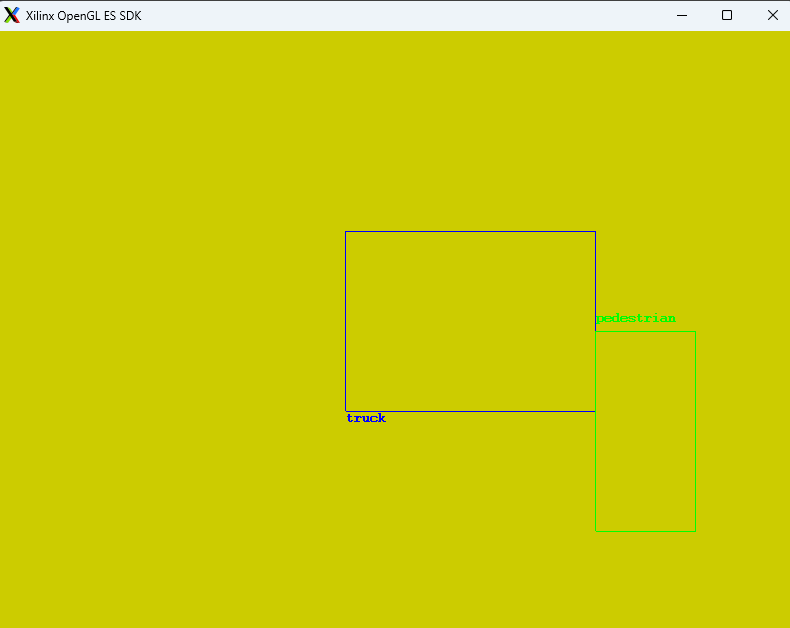

**📁 Source**: `samples/opengles/opengl_es_2.0/bbox/`

**Supported Window Environments:** ✅ FBDEV  ✅ X11  ✅ Wayland

**Description:** Demonstrates bounding-box rendering, reading the bbox
coordinates and class label from a text file in the same directory.

**Key Techniques:** BBOX rendering, on-screen text

---

### **OpenGL ES 3.0 Samples**

#### 1. **Compute Particles Sample**
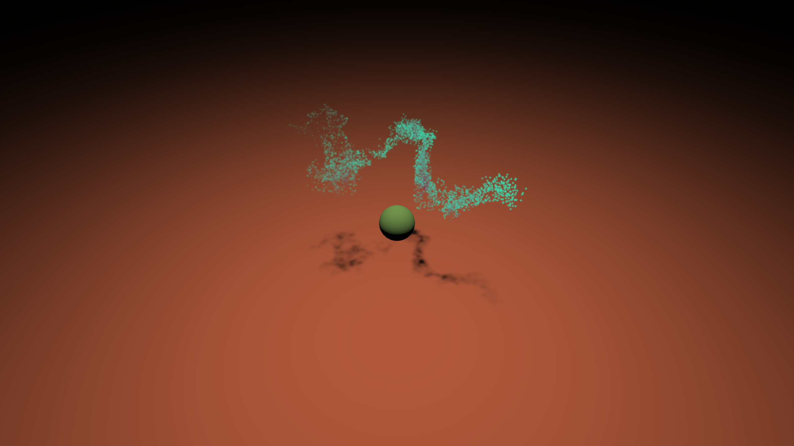

**📁 Source**: `samples/opengles/opengl_es_3.0/compute_particles/`

**Supported Window Environments:** ✅ FBDEV  ✅ X11  ✅ Wayland

**Description:** GPU compute-shader particle system using modern OpenGL ES 3.x
compute capabilities for high-performance particle simulation.

**Key Techniques:** GPU compute shaders, SSBO, compute dispatch, memory barriers, parallel processing

---

#### 2. **Occlusion Culling Sample**
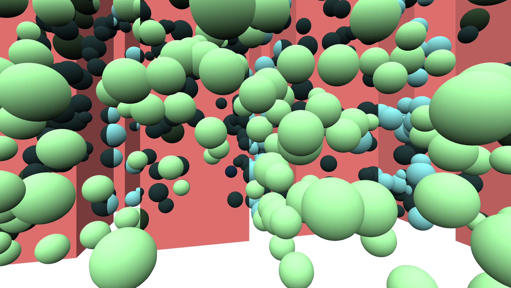

**📁 Source**: `samples/opengles/opengl_es_3.0/occlusion_culling/`

**Supported Window Environments:** ✅ FBDEV  ✅ X11  ✅ Wayland

**Description:** Visibility optimization using Hi-Z GPU occlusion culling for
improved rendering performance in complex scenes.

**Key Techniques:** Hi-Z occlusion, indirect rendering, visibility optimization

---

#### 3. **OpenCL Matrix Multiplication Sample**

**📁 Source**: `samples/opengles/opengl_es_3.0/opencl_matmul/`

**Description:** Demonstrates GPGPU computing using OpenCL for high-performance
matrix operations with OpenGL ES interoperability (built only when OpenCL is
found).

**Key Techniques:** GPGPU computing, OpenCL interop, matrix operations, parallel computing

---

## OpenCL Samples

#### 1. **Hello World OpenCL**

**📁 Source**: `samples/opencl/hello-world-opencl/`

**Description:** Basic integer array addition implemented in an OpenCL kernel. Produces
no image or result file; it only prints kernel profiling information on completion,
confirming that an OpenCL device is available and the kernel ran.

**Key Techniques:** OpenCL initialization, kernel creation, buffer management, basic parallel computation

---

#### 2. **Hello World C**

**📁 Source**: `samples/opencl/hello-world-c/`

**Description:** CPU-only baseline that performs the same integer array addition in
plain C/C++ (no OpenCL). It prints nothing and writes no file — if it runs and exits
successfully, your C/C++ toolchain works.

**Key Techniques:** C-style OpenCL API usage, context creation, simple kernel execution

---

#### 3. **Mandelbrot Set**


**📁 Source**: `samples/opencl/mandelbrot/`

**Description:** Generates Mandelbrot fractal data, testing each pixel to
determine the iterations needed to rule out set membership, output as a grayscale
bitmap (`output.bmp`).

**Key Techniques:** Parallel fractal computation, 2D indexing, mathematical computation on GPU

---

#### 4. **Mandelbrot Benchmark**


**📁 Source**: `samples/opencl/mandelbrot-benchmark/`

**Description:** Performance-focused Mandelbrot generator with timing and image
perturbation for benchmarking GPU compute. Expects a 1024x1024 `assets/input.bmp`.

**Key Techniques:** Performance measurement, GPU benchmarking, optimized parallel computation

---

#### 5. **Image Scaling**


**📁 Source**: `samples/opencl/image-scaling/`

**Description:** Uses OpenCL image objects and a sampler to resize images on the
GPU.

**Key Techniques:** OpenCL image objects, 2D image processing, bilinear interpolation, image resampling

---

#### 6. **Sobel Filter**
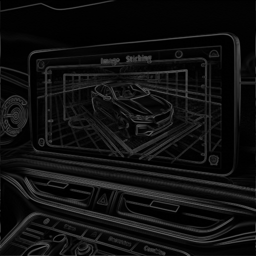

**📁 Source**: `samples/opencl/sobel-filter/`

**Description:** Edge detection using the Sobel operator with vector loads,
computing X and Y gradients and combining them. Expects an `assets/input.bmp`
whose width is a multiple of 16.

**Key Techniques:** Edge detection, convolution kernels, gradient computation, vector loads

---

#### 7. **Sobel Filter (No Vectors)**


**📁 Source**: `samples/opencl/sobel-filter-no-vectors/`

**Description:** Sobel edge detection without vector types — one pixel per work
item — demonstrating an alternative optimization approach.

**Key Techniques:** Scalar-based image processing, alternative optimization strategies, edge detection

---

#### 8. **Gaussian Filter**
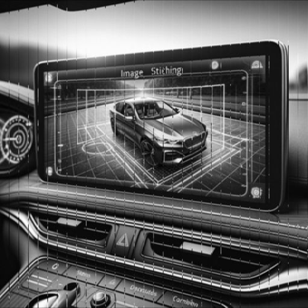

**📁 Source**: `samples/opencl/gaussian-filter/`

**Description:** Applies a Gaussian blur to a PNG image (`assets/input.png`) for
noise reduction and smoothing.

**Key Techniques:** Gaussian blur, separable convolution, image smoothing, noise reduction

---

#### 9. **Convolution Filter**


**📁 Source**: `samples/opencl/convolution-filter/`

**Description:** General-purpose 3x3/5x5 convolution filtering framework
supporting various kernel types.

**Key Techniques:** General convolution, custom kernels, flexible image processing framework

---

#### 10. **FIR Filter**
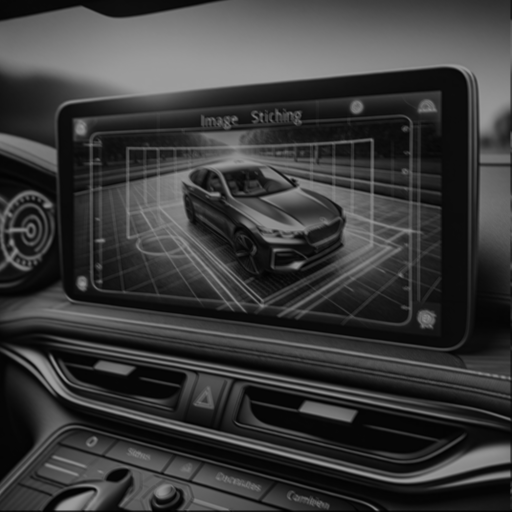

**📁 Source**: `samples/opencl/fir-filter/`

**Description:** Finite Impulse Response filtering for signal and image
processing on the GPU.

**Key Techniques:** FIR filtering, signal processing, digital filter implementation

---

#### 11. **Depth Map**
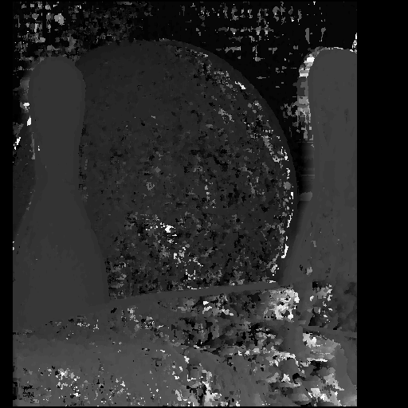

**📁 Source**: `samples/opencl/depth-map/`

**Description:** Stereo-vision depth map generation for obstacle detection.
Expects a stereo pair `assets/left.bmp` and `assets/right.bmp`.

**Key Techniques:** Stereo vision, depth estimation, correlation algorithms, 3D reconstruction

---

#### 12. **ML Classifier**


**📁 Source**: `samples/opencl/ml-classifier/`

**Description:** Simple ML image classifier that computes average intensity and
applies a linear classifier to label images as "Bright" or "Dark".

**Key Techniques:** Machine learning, image classification, statistical analysis, feature extraction

---

#### 13. **Matrix Multiply**

**📁 Source**: `samples/opencl/matrix-multiply/`

**Description:** High-performance SGEMM benchmark suite with many kernel variants
(local memory, work-group optimization, tiling). Run `./matrix_multiply -h` for
options including `-va` (validate vs. CPU) and `-csv <file>`.

**Key Techniques:** Matrix operations, local memory optimization, work-group coordination, linear algebra

---

#### 14. **Integer 64-bit**

**📁 Source**: `samples/opencl/integer-64-bit/`

**Description:** Computes the sum and the sum-of-squares of an image's pixel
(luminance) values using 64-bit integers and atomics, then prints both totals to
the console (no image or result file is written). Reads `assets/input.bmp` and
requires the `cl_khr_int64_base_atomics` device extension.

**Key Techniques:** 64-bit arithmetic, extended precision, atomics

---

#### 15. **SGEMM**

**📁 Source**: `samples/opencl/sgemm/`

**Description:** Single-precision general matrix multiply (`alpha*A*B + beta*C`)
showcasing optimized linear algebra operations.

**Key Techniques:** BLAS operations, optimized matrix multiplication, performance tuning

---

#### 16. **Vector Hello World**

**📁 Source**: `samples/opencl/vector-hello-world/`

**Description:** Introduction to vector operations in OpenCL, demonstrating SIMD
programming patterns and vector data types.

**Key Techniques:** Vector operations, SIMD programming, parallel data processing

---

#### 17. **OpenCL Template**

**📁 Source**: `samples/opencl/opencl-template/`

**Description:** Minimal boilerplate skeleton for creating new OpenCL
applications with standard setup and error handling.

**Key Techniques:** Project template, best practices, error handling, code organization

---

#### 18. **ADAS Lane Detection**
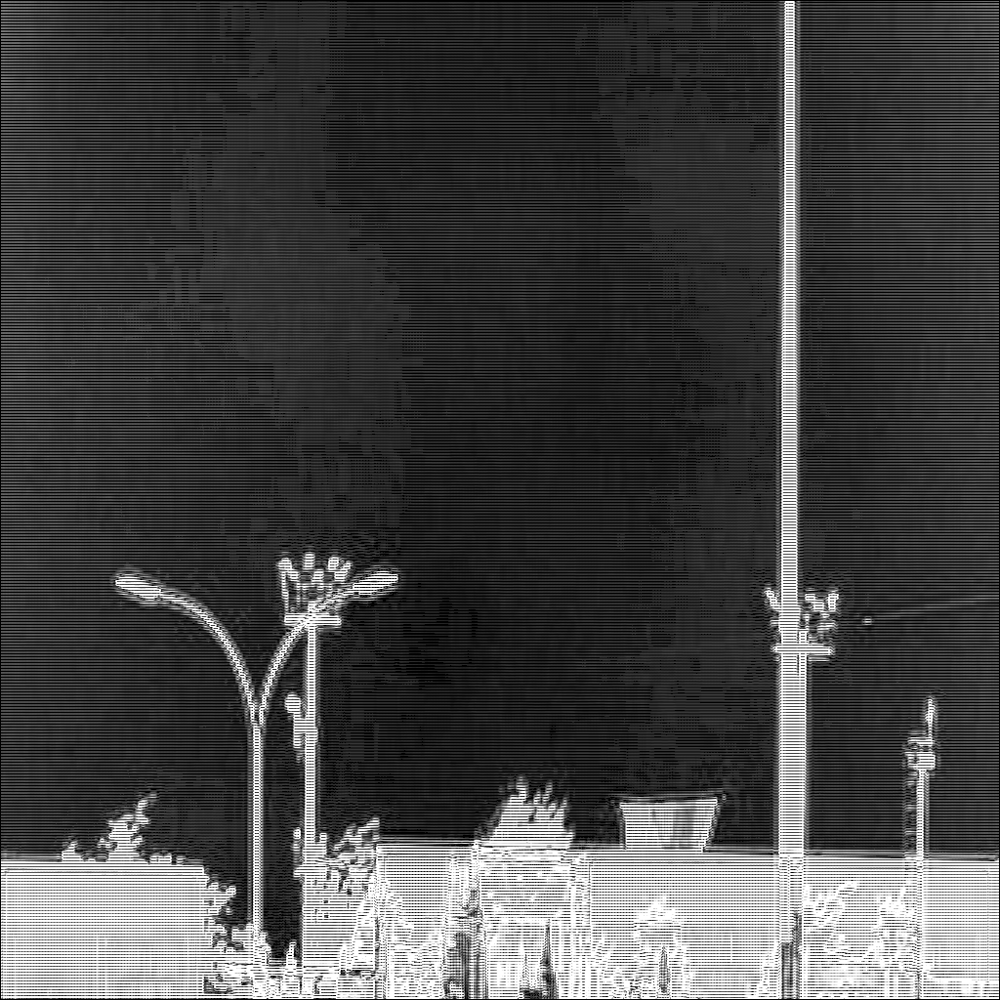

**📁 Source**: `samples/opencl/adas-lane-detection/`

**Description:** Lane visualization via Sobel edge detection (ADAS use case).
Expects a 1024x1024 `assets/input.bmp`.

**Key Techniques:** Edge detection, ADAS, image processing

---

## Vulkan Samples

#### 1. **Triangle**
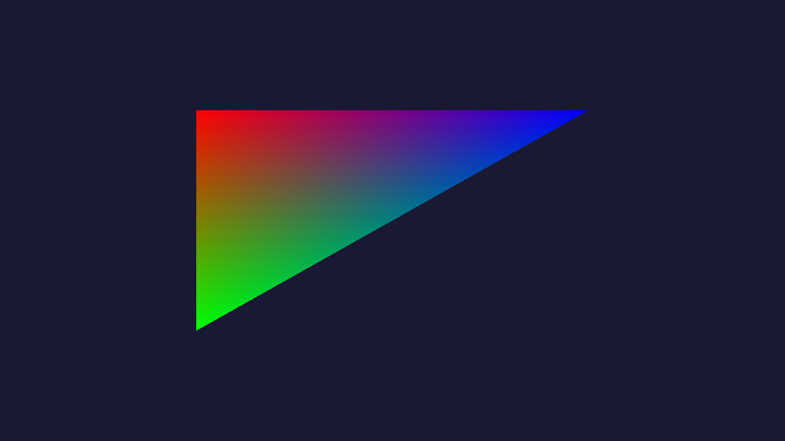

**📁 Source**: `samples/vulkan/triangle/`

**Supported Platforms:** ✅ Wayland  ✅ X11 (Display/DRM-KMS)

**Description:** Minimal Vulkan sample that renders a single triangle.
Demonstrates swapchain setup, render passes, and the basic graphics pipeline.

**Key Techniques:** Vulkan initialization, swapchain, render pass, graphics pipeline, vertex buffers

---

#### 2. **Texture (Rotating)**
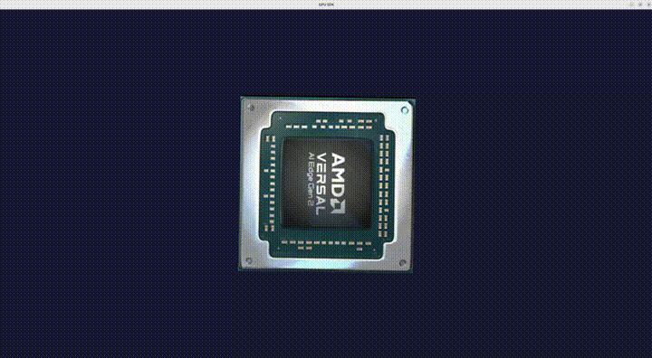

**📁 Source**: `samples/vulkan/texture/`

**Supported Platforms:** ✅ Wayland  ✅ X11 (Display/DRM-KMS)

**Description:** Renders a textured quad and animates its rotation. Demonstrates
texture loading, samplers, and uniform buffer updates.

**Key Techniques:** Texture loading, samplers, uniform buffers, animation, transformation matrices

---

#### 3. **Basic Compute**
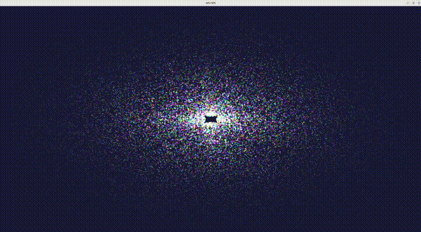

**📁 Source**: `samples/vulkan/basic-compute/`

**Supported Platforms:** ✅ Wayland  ✅ X11 (Display/DRM-KMS)

**Description:** Compute-shader particle simulation rendered via graphics,
demonstrating compute-to-graphics synchronization and storage buffers.

**Key Techniques:** Compute shaders, storage buffers, memory barriers, dispatch, particle simulation

---

#### 4. **Multithreading**
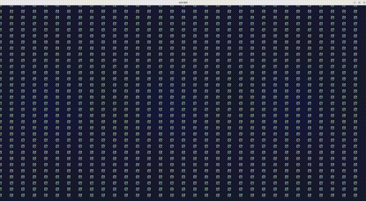

**📁 Source**: `samples/vulkan/multithreading/`

**Supported Platforms:** ✅ Wayland  ✅ X11 (Display/DRM-KMS)

**Description:** Multi-threaded secondary command buffer recording and submission
for improved CPU-side performance.

**Key Techniques:** Multithreaded command buffers, synchronization, parallel rendering

---

#### 5. **Multisampling**
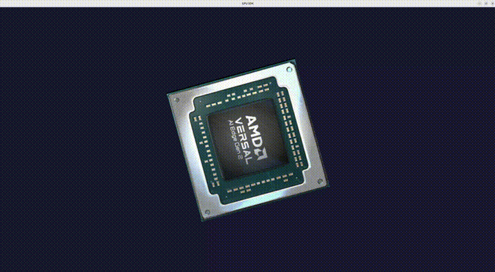

**📁 Source**: `samples/vulkan/multisampling/`

**Supported Platforms:** ✅ Wayland  ✅ X11 (Display/DRM-KMS)

**Description:** Enables and uses multisample anti-aliasing (MSAA) for smoother
rendering.

**Key Techniques:** Multisample anti-aliasing, render pass setup, resolve attachments

---

#### 6. **Spinning Cube**
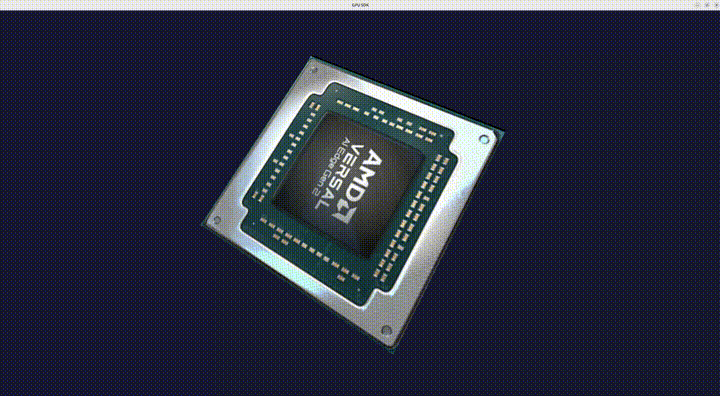

**📁 Source**: `samples/vulkan/spinning-cube/`

**Supported Platforms:** ✅ Wayland  ✅ X11 (Display/DRM-KMS)

**Description:** Renders a textured 3D cube with rotation animation and depth
buffering.

**Key Techniques:** 3D transformations, depth buffer, animation, uniform buffers

---

#### 7. **Multi-pass Rendering**
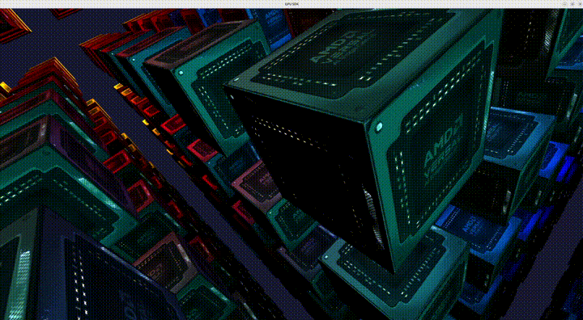

**📁 Source**: `samples/vulkan/multipass/`

**Supported Platforms:** ✅ Wayland  ✅ X11 (Display/DRM-KMS)

**Description:** Deferred shading using multiple subpasses and framebuffers,
useful for post-processing and advanced rendering effects.

**Key Techniques:** Render passes, subpasses, framebuffers, image attachments, post-processing

---

#### 8. **ASTC Texture Compression**
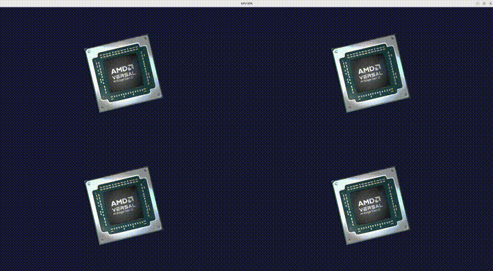

**📁 Source**: `samples/vulkan/astc/`

**Supported Platforms:** ✅ Wayland  ✅ X11 (Display/DRM-KMS)

**Description:** Loads and displays ASTC compressed textures, with fallback to
PNG if ASTC is not supported.

**Key Techniques:** ASTC texture loading, compressed textures, format fallback

---

#### 9. **Mipmapping**
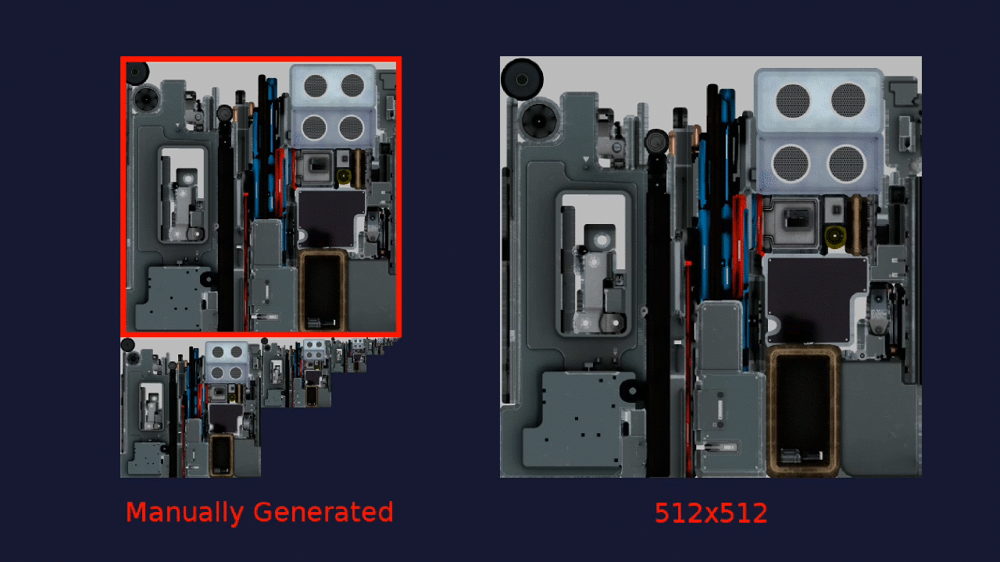

**📁 Source**: `samples/vulkan/mipmapping/`

**Supported Platforms:** ✅ Wayland  ✅ X11 (Display/DRM-KMS)

**Description:** Shows the use and visual effect of mipmaps, demonstrating both
pre-generated and GPU-generated mipmaps.

**Key Techniques:** Mipmaps, texture sampling, image blitting, LOD selection

---

# 🏗️ Framework Architecture

The unified SDK provides shared support libraries under `lib/sdk/`, reused by all
sample sets:

- **common** — Graphics-API-agnostic helpers (math, timing, image I/O, file
  utilities).
- **egl** — EGL context/surface management for the OpenGL ES samples.
- **gles** — OpenGL ES helper classes and the `SdkGlesFramework` windowing
  abstraction (Wayland / X11 / fbdev), font rendering, texture and matrix
  utilities.
- **vulkan** — RAII-style Vulkan helper classes (context, swapchain, command
  buffers, assets) backing the Vulkan samples.
- **vulkan-strings / vulkan-vendor-ids** — Debugging helpers that resolve Vulkan
  enums and GPU vendor names to human-readable strings.

The OpenCL samples build on the shared `common` image/bitmap helpers plus a thin
OpenCL context/kernel management layer.

# 🔧 Adding New Samples

The build system is designed to be general. To add a new sample, copy an existing
one in the relevant `samples/<api>/` directory, rename the target in its
`CMakeLists.txt`, and add an `add_subdirectory(<newsample>)` to the parent
`CMakeLists.txt`. Place source files in the sample folder, shaders/kernels and
data under the sample's `Supportingfiles/`, `shaders/`, `assets/`, or
`cl_kernels/` directory as appropriate.

# 📄 License

This project is licensed under the terms in the [LICENSE](LICENSE) file.
